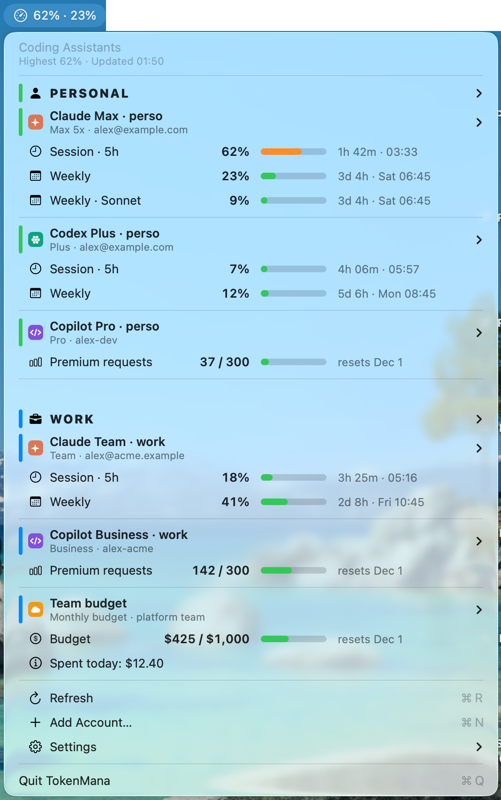
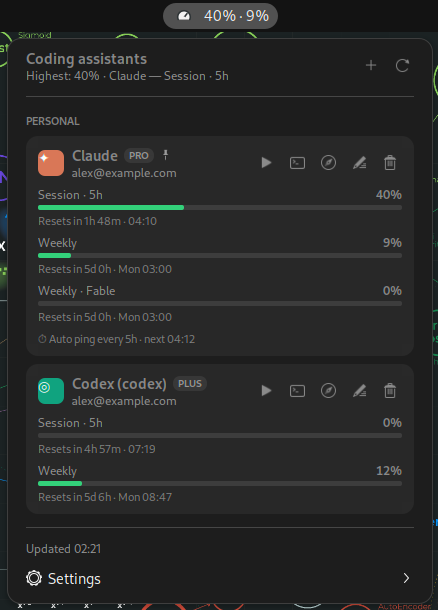

<div align="center">

# TokenMana

**How much mana is left in each of your coding assistants, from the menu bar.**

[](core/)
[](core/)
<br>
[](https://github.com/Valkea/TokenMana/tags)
[](LICENSE)
[](https://github.com/Valkea/TokenMana/commits/main)
<br>
[](#install)
[](#install)

[Install](#install) · [Accounts](#accounts) · [Ping](#ping) · [Your own provider](#your-own-provider) · [Settings & backup](#settings-and-backup) · [Config reference](#config-reference)

</div>

One glance at every coding-assistant subscription: session (5 h) and weekly usage with reset
countdowns, monthly premium-request quotas, and budget spend. One click **pings** an account
with its smallest model at low effort, which starts its 5 h session timer early.
<table>
<tr>
<td>Menu on macOS</td>
<td>Menu on Ubuntu</td>
</tr>
<tr>
<td>
  
</td>
<td>
  
</td>
</tr>
</table>

- 📊 **All your quotas in one menu**: Claude, Codex, Copilot, and any source you can script.
- 👥 **Several accounts per vendor** (perso, work, client…), each with its own login, sorted into coloured groups.
- ⚡ **Ping and auto ping**: start a 5 h session early, every 5 h or at the times you choose.
- 🖥️ **Native on both desktops**: a macOS menu-bar app and a GNOME top-bar extension, sharing one core.
- 🔒 **Local and dependency-free**: one Python file, no telemetry; your logins are read only to call the usage endpoints.

The same, from the terminal:

```text
$ mana status
PERSONAL
Claude Pro · perso  Pro · me@example.com
  Session · 5h               ███░░░░░░░              30%  resets in 2h 40m
  Weekly                     █░░░░░░░░░               8%  resets in 5d 1h
  ⏱ Auto ping every 5h · next 04:13

Codex Plus · perso  Plus · me@example.com
  Session · 5h               ░░░░░░░░░░               0%  resets in 4h 57m
  Weekly                     █░░░░░░░░░              12%  resets in 5d 7h

WORK
Copilot · company  Business · me-work
  Premium requests           █████░░░░░        142 / 300  resets in 19d 23h
```

| Platform | UI | Where |
|---|---|---|
| macOS 14+ | menu-bar app (native `NSMenu`) | `macos/` |
| Ubuntu 24.04 (GNOME 45–49) | top-bar extension | `gnome/` |
| both | `mana` CLI = the shared core both UIs call | `core/` |

The core is dependency-free Python (3.9+): `core/mana.py` is the entry point and the code is in the
`core/tokenmana/` package, one module per provider in `providers/`. Every provider integration lives
there, so the two UIs stay thin and behave identically.

## Install

No need to clone the repo: this downloads the latest release, installs it, and deletes the download.

```sh
curl -fsSL https://raw.githubusercontent.com/Valkea/TokenMana/main/install.sh | bash    # macOS
wget -qO- https://raw.githubusercontent.com/Valkea/TokenMana/main/install.sh | bash     # Ubuntu
```

Run it again to update. `… | TOKENMANA_VERSION=v0.2.2 bash` installs a given version. From a clone:

```sh
./install.sh          # macOS: builds + installs ~/Applications/TokenMana.app
                      # Ubuntu: installs the GNOME extension (log out/in once, then enable)
```

On Ubuntu, re-running the installer after an update reloads the running extension in place, with no log out:
`extension.js` is a small loader that imports a fresh copy of `indicator.js` (the whole UI) on each enable.
Only changes to `extension.js`, `metadata.json` or the settings schema need a log out/in.

macOS needs only the Xcode Command Line Tools (no Xcode). Turn on *Settings → Launch at Login* in the menu.

## Accounts

Add as many accounts of each type as you like: **Add Account… (⌘N)** in the menu (macOS), the add
button (GNOME), or the CLI:

```sh
mana add claude  --label "Claude Max · work"     # → own config dir ~/.claude-max-work
mana add codex   --label "Codex Pro · client"    # → own CODEX_HOME ~/.codex-pro-client
mana add copilot --label "Copilot · company"     # GitHub device-code sign-in
mana add command --label "Team budget" --command "my-usage --json"   # your own provider, see below
mana login <id>        # sign in (the UIs do this for you after "Add & sign in")
mana edit <id> --label "New name" [--group Work] [--host mycorp.ghe.com]
mana remove <id>
```

In the menus: an account's submenu → *Edit Account…* (macOS), or its ✎ button (GNOME), to rename it, change its
group or change its GitHub host.

**Groups** (e.g. *Work* / *Personal*): give accounts a group when adding or editing them, or on macOS use the
account's submenu → *Move to Group ▸*. The menu then shows one section per group, with accounts sorted by name and
ungrouped accounts under *Other*. Group names ignore case (`work` joins `Work`). To set the order of the sections,
add `"groups": ["Work", "Personal"]` to the config; otherwise they are alphabetical. Each group has a colour bar
along the left of its rows: pick it from the group header's submenu → *Color*, or with
`mana group-color Work blue` (blue, green, purple, orange, pink, teal, red, gray).

| Type | Shows | Data source |
|---|---|---|
| `claude` (Pro/Max) | session 5 h, weekly (+ per-model weekly, extra-usage spend when enabled) | Claude Code OAuth login → `api.anthropic.com/api/oauth/usage` (same as `/usage`) |
| `codex` (ChatGPT Plus/Pro/Business) | 5 h window, weekly, credits | Codex CLI login (`$CODEX_HOME/auth.json`) → `chatgpt.com/backend-api/wham/usage`; falls back to the last rate-limit snapshot in Codex session logs |
| `copilot` | premium requests used / entitlement, monthly reset, overage | GitHub device flow → `api.github.com/copilot_internal/user` |
| `command` | whatever your command reports (budgets, quotas, …) | any command printing TokenMana JSON, see [Your own provider](#your-own-provider) |

**Several subscriptions of the same vendor on one machine.** Each Claude/Codex account gets its own
config dir, so logins don't overwrite each other. To use one from a terminal (account submenu →
*Copy Terminal Command* on macOS, terminal icon on GNOME):

```sh
CLAUDE_CONFIG_DIR=~/.claude-max-work claude
CODEX_HOME=~/.codex-pro-client codex
```

The first account of each type uses the default dir (`~/.claude`, `~/.codex`), the one plain
`claude`/`codex` already use.

**Copilot client vs company:** sign each one in with the GitHub account that holds that seat.
**GitHub Enterprise with data residency (GHE.com)**: set the account's GitHub host, e.g. `mycorp.ghe.com` (in the Add
Account window, *Edit Account…*, or `--host`). Sign-in then happens at `https://mycorp.ghe.com/login/device` and usage comes
from `https://api.mycorp.ghe.com`. Finish the tenant's onboarding in the browser first (device enrolment, SSO), so the
device-code page just asks you to authorize. Changing the host signs the account out. Instead of the device flow you can use
`"token_cmd": "gh auth token --user <login>"` or `"token_env": "VAR"`.

## Ping

`mana ping <id>` / `--idle` / `--all`, or *Ping Now* / *Ping Idle Sessions* in the menu (▶ on GNOME). It sends one tiny prompt with tools, MCP
servers, hooks and session persistence disabled, from an empty temp dir:

- Claude: `claude -p --model haiku --effort low …`
- Codex: `codex exec -m gpt-5.1-codex-mini -c model_reasoning_effort="low" …`

Override per account:

```json
{ "id": "codex-perso", "type": "codex", "ping": { "model": "gpt-5.1-codex-mini", "effort": "low" } }
```

Set `"ping": false` to hide the button. Copilot and command accounts have no session timer, so they
have no ping.

### Auto ping

Each Claude/Codex account can ping on its own (account submenu → *Auto Ping ▸* on macOS, ✎ on GNOME, or the CLI):

```sh
mana edit claude-perso --auto-ping 5h                    # 5 h 1 min after each ping
mana edit claude-work  --auto-ping "08:00,13:01,18:02"   # at these times (24 h, this computer's clock)
mana edit claude-work  --auto-ping off
```

- **Every 5h**: pings again 5 h 1 min after the last ping (manual or automatic), so a new session starts as soon as
  the previous one has ended. If a session is already running (you used the account), it waits until that session's
  reset + 1 min. If the computer was asleep, it pings as soon as it wakes. A failed ping is retried every 15 min.
- **At set times**: pings at each time. If the computer was asleep or off at one of them (more than 5 min late), it
  does **not** ping on wake: it asks (notification + the account's card, ⏰ next to the menu-bar/top-bar icon) whether
  to *Ping now* or *Wait for* the next time. Several missed times make one question. If a session is already running,
  there is nothing to start, so it does not ask. A failed ping asks the same question, with the error.

The apps run `mana auto-ping` every minute while they are running. Without them (a server, say), use cron:
`* * * * * ~/.local/bin/mana auto-ping`. Missed-time questions are then in `mana status`; answer with
`mana ping <id>` or `mana auto-ping --dismiss <id>`. The config is shared between machines, so every machine
that runs the app auto-pings that account (a second ping in a running session only costs a few tokens).

## Your own provider

A `command` account runs any program and shows what it prints. Use it for a usage source TokenMana does not
know: an internal budget API, a gateway, a billing export. The program can be written in any language. It runs
from your home directory with no stdin, a 90 s timeout and the usual install dirs on `PATH`, every
`refresh_minutes` (15 by default for this type).

It prints one JSON object on stdout (log lines before it are ignored):

```json
{
  "plan": "Team budget",
  "identity": "me@example.com",
  "vendor": "bedrock",
  "metrics": [
    { "key": "budget", "label": "Budget", "percent": 42.5, "text": "$425 / $1,000", "resets_at": "2026-12-01T00:00:00Z" },
    { "key": "team", "label": "Team", "percent": 12, "text": "$1,200 / $10,000", "resets_at": "2026-12-01T00:00:00Z" }
  ],
  "notes": ["Spent today: $3.20"]
}
```

| Field | Meaning |
|---|---|
| `metrics[].key` / `label` | id and display name of the gauge; `percent` (0–100) drives the bar and the menu-bar figure |
| `metrics[].text` | text next to the bar (default: the percentage); `resets_at` (ISO time or epoch) shows a countdown |
| `metrics[].window_seconds` / `idle` | optional: length of a rolling window; `idle: true` shows *idle* |
| `plan`, `identity`, `notes` | optional: plan badge, account name, extra lines under the gauges |
| `vendor` | optional badge: `anthropic`, `openai`, `github`, `bedrock` or `command` (default) |

When it cannot get the data, it prints `{"error": "Credentials expired", "hint": "Run my-login first"}` (any exit
code), or exits non-zero: the first line of stderr is then the error. An account's `login_hint`, if set, replaces the hint.
Add `"setup": true` to an error that means "not set up on this device".

Organisations can ship such commands, with an installer that runs this repo's `install.sh` and adds the
accounts, in a separate internal repo. TokenMana itself then needs no changes for them.

## Settings and backup

Everything TokenMana knows is in two hidden folders of your home directory (same paths on macOS and Linux;
`mana paths` prints them):

| File | Holds | Back it up? |
|---|---|---|
| `~/.config/tokenmana/config.json` | your accounts and their names, groups, colours, auto-ping times, the menu-bar choice: every setting, **no credentials** | **yes** |
| `~/.config/tokenmana/secrets.json` | Copilot sign-in tokens (file readable only by you) | no: sign in again instead; never share or commit it |
| `~/.cache/tokenmana/` | last usage fetched, auto-ping state | no: rebuilt on its own |

Claude and Codex logins are not TokenMana's: they stay where those CLIs keep them (the macOS Keychain or
`~/.claude*/.credentials.json`, and `~/.codex*/auth.json`).

**Open the folder.** `.config` starts with a dot, so Finder and file managers hide it. On macOS press ⌘⇧G in Finder
and paste `~/.config/tokenmana` (⌘⇧. shows hidden files), or run `open ~/.config/tokenmana`; on Ubuntu,
`xdg-open ~/.config/tokenmana` (Ctrl+H shows hidden files).

**Back up / share a setup.** `config.json` alone is a complete, credential-free preset of your accounts: copy it
anywhere, or keep it in your dotfiles (e.g. `chezmoi add ~/.config/tokenmana/config.json`), which also syncs it
between your machines. Keep `secrets.json` out. Never paste a token into `config.json`: `token_cmd` / `token_env`
name a command or a variable, not the token itself.

**Restore on a new machine.**

1. Put `config.json` in `~/.config/tokenmana/` **before** installing (the installer only creates a config when there is none).
2. [Install](#install).
3. Sign in to each account: *Sign In* in its menu, or `mana login <id>`.

`TOKENMANA_CONFIG_DIR` / `TOKENMANA_CACHE_DIR` move these folders elsewhere (`XDG_CONFIG_HOME` / `XDG_CACHE_HOME` are honoured too).

## Config reference

`~/.config/tokenmana/config.json` is the same file on both machines (see [Settings and backup](#settings-and-backup)):

```json
{
  "refresh_minutes": 5,
  "menubar": "max",
  "accounts": [
    { "id": "claude-perso", "label": "Claude Pro · perso", "type": "claude" },
    { "id": "team-budget", "label": "Team budget", "type": "command",
      "command": "my-usage --json", "platforms": ["macos"], "refresh_minutes": 15 }
  ]
}
```

| Key | Meaning |
|---|---|
| `menubar` | `"max"` (the highest % across accounts) or `"<account-id>:<metric>"`, e.g. `"claude-perso:session"` |
| `group` | section the account is listed in (`"groups": [...]` at the top level sets the section order) |
| `platforms` | `["macos"]` / `["linux"]`: only show the account on that OS |
| `enabled` | `false` hides the account |
| `refresh_minutes` | per account or global; the UIs poll every minute and the core only fetches what is due |
| `auto_ping` | `{"mode": "interval"}` (every 5 h 1 min) or `{"mode": "times", "times": ["08:00", "13:01"]}`; see [Auto ping](#auto-ping) |
| `config_dir` / `codex_home` | Claude / Codex config dir of the account |
| `command` / `login_hint` | `command` accounts: what to run, and the hint shown when it fails |
| `vendor` | badge of the account (`anthropic`, `openai`, `github`, `bedrock`, `command`) |
| `dashboard_url` | override (or `null` to hide) the "open usage page" button |

Claude/Codex tokens are read where those CLIs keep them, only to call the usage endpoints. They are never
written to the cache or printed.

## Notes

- The Claude, Codex and Copilot usage endpoints are the ones their own clients use. They are not
  public APIs and may change; if a provider breaks, the fix goes in its module in `core/tokenmana/providers/`.
- An expired Claude login token (e.g. after a night asleep) is renewed on the next refresh by running
  `claude auth status`, which sends no prompt. If that fails (offline, no `claude` CLI, revoked login) the
  card keeps the last data (marked ⚠); windows whose reset time has passed drop to 0 / *idle*. Using
  the tool once, or pinging it, refreshes the token.

## License

[MIT](LICENSE)
